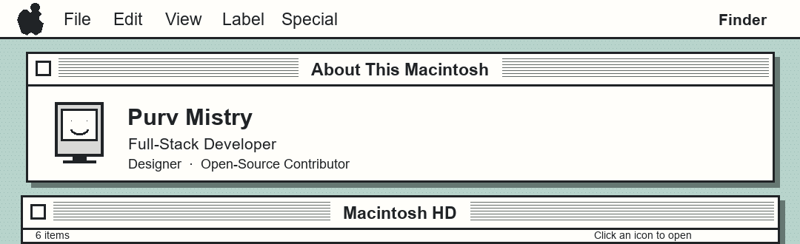
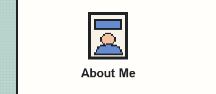
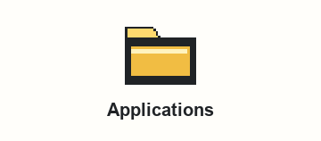
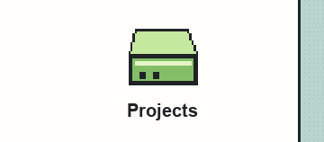
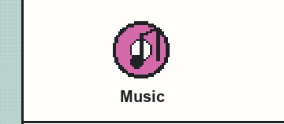
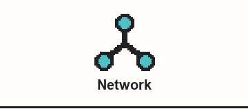
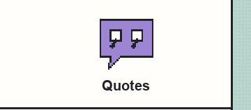
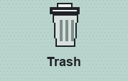

<table align="center" width="100%" border="0" cellpadding="0" cellspacing="0">
  <tr>
    <td colspan="6"></td>
  </tr>
  <tr>
    <td colspan="2" width="33.33%"></td>
    <td colspan="2" width="33.33%"></td>
    <td colspan="2" width="33.33%"></td>
  </tr>
  <tr>
    <td colspan="2" width="33.33%"></td>
    <td colspan="2" width="33.33%"></td>
    <td colspan="2" width="33.33%"></td>
  </tr>
  <tr>
    <td colspan="5" width="83.33%"></td>
    <td width="16.67%"></td>
  </tr>
</table>
